# CamDock

> Lightweight desktop camera windows for UniFi Protect.

A lightweight native Windows viewer for UniFi Protect, written in C# (.NET 8, WinForms). Each camera plays its Protect RTSP stream through LibVLC, using hardware decoding and drawing straight into its window. The app has no main window: it lives in the tray, and each camera you tick there opens as its own borderless, snapping desktop window.

## Download

Get **`CamDock.exe`** from the [latest release](https://github.com/powlette/CamDock/releases/latest) and run it. There's nothing to install: it's a single self-contained file for Windows 10 (1809+) and Windows 11 x64. CamDock isn't code-signed, so SmartScreen may warn the first time; choose **More info › Run anyway**.

## Screenshots

**A camera on the desktop.** Borderless and resizable, it snaps to screen edges and to other camera windows, with mouse-wheel zoom.

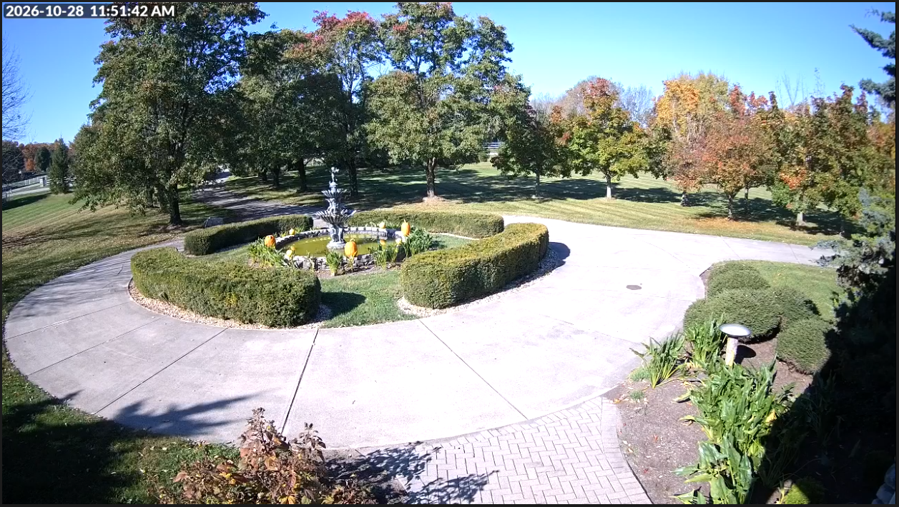

**Doorbell pop-up.** When someone rings, the doorbell's live window pops up on top with a red border. The doorbell menu sends a quick reply to its screen.

| Doorbell pop-up | Doorbell menu |
|---|---|
| 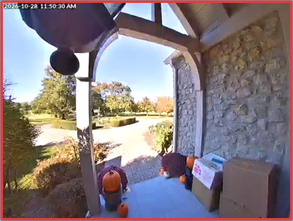 | 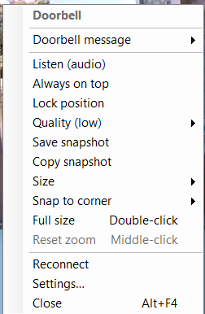 |

**Tray and camera menus.** Tick the cameras you want, snooze alerts, open history and settings. Each camera has its own right-click menu.

| Tray menu | Alerts submenu | Camera menu |
|---|---|---|
| 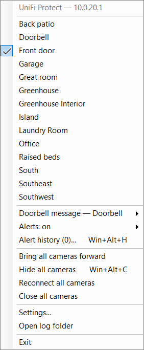 | 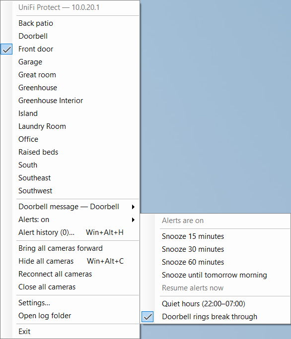 | 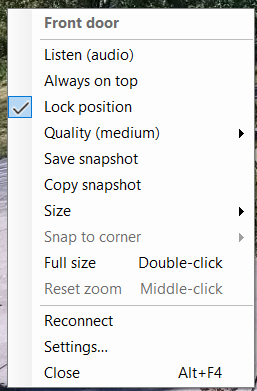 |

**Setup and settings**

| First-run setup | Connection and streams |
|---|---|
| 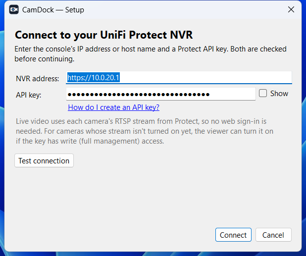 | 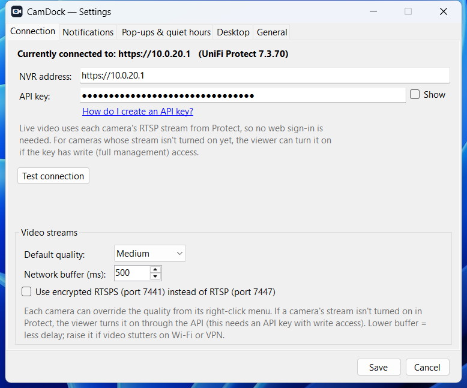 |

| Notifications per camera | Pop-ups, quiet hours and doorbell replies |
|---|---|
| 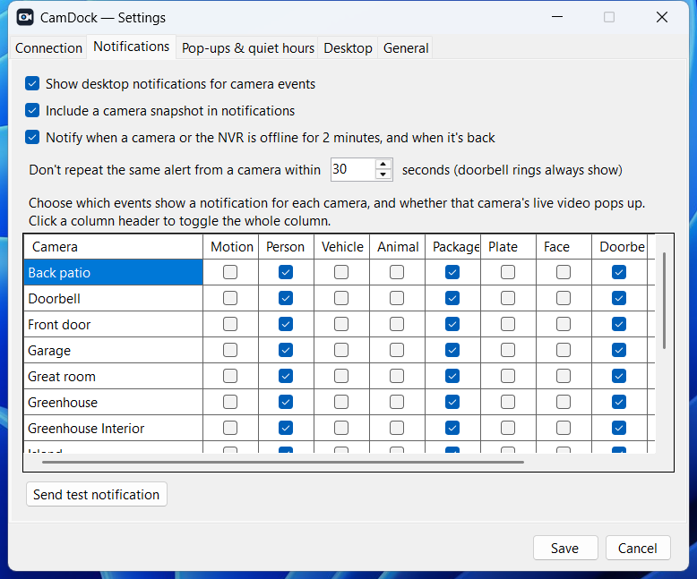 | 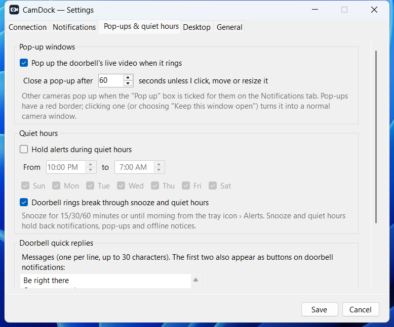 |

| Shortcuts, quality and idle | General |
|---|---|
| 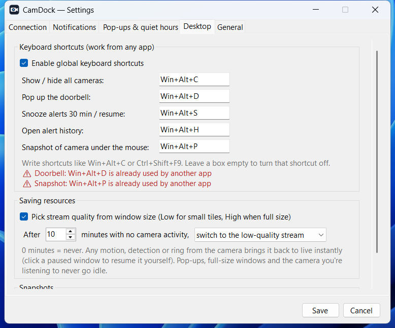 | 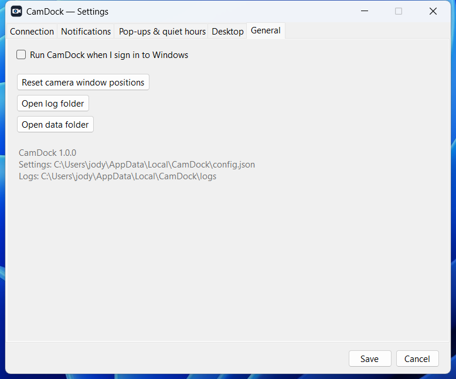 |

**Alert history** (the last 24 hours, with snapshots)

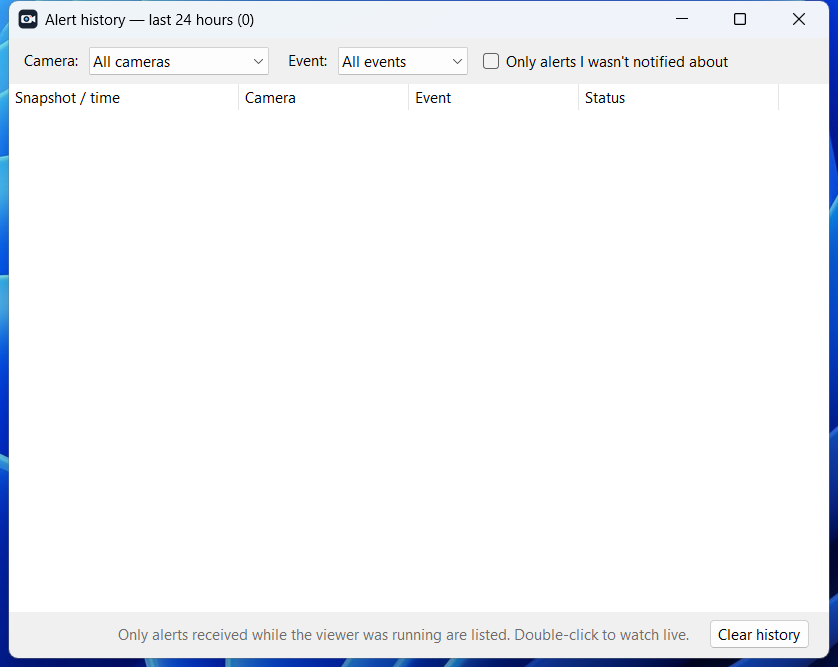

## Build from source

Requirements on the build PC: **.NET 8 SDK** (x64).

```
build.cmd            (double-click)    or    powershell -File build.ps1
```

This runs:

```powershell
dotnet publish -c Release -r win-x64 --self-contained true -p:PublishSingleFile=true -p:IncludeNativeLibrariesForSelfExtract=true -o PUBLISH
```

The output is **`PUBLISH\CamDock.exe`**, a single self-contained file of about 94 MB. Nothing else needs installing: no .NET runtime, no WebView2, no VLC. The first launch unpacks the bundled player into a cache folder, which takes a few seconds; later launches are instant.

## First run

1. Enter the console's **IP address or host name** (for example `192.168.1.1` or `https://unvr.local`) and a **Protect API key**. To create a key: Protect › Settings › Control Plane › Integrations › Create API Key.
2. The app checks both against the Integration API (`/proxy/protect/integration/v1/meta/info`) before saving anything.

That's all. There is no web sign-in.

Settings are saved to `%LOCALAPPDATA%\CamDock\config.json`, with the API key encrypted by Windows DPAPI for your user account.

## How video works

When a camera window opens, the app asks the Integration API for the camera's stream (`GET /v1/cameras/{id}/rtsps-stream`).

* **If the chosen quality isn't enabled yet,** the app turns it on with `POST /v1/cameras/{id}/rtsps-stream`. This needs an API key with **write (full management) access**.
* **If the key is read-only,** the app falls back to any quality that is already enabled. If none is enabled, it tells you to turn one on in Protect: the camera's Settings › Advanced › RTSPS stream.
* **Connection type:** by default it plays Protect's plain RTSP listener on **port 7447**, over TCP. Settings › Connection › Video streams can switch to encrypted **RTSPS on port 7441**.
* **Quality:** the default is Medium. Each window can override it from its right-click menu (High, Medium or Low).
* **Audio:** muted windows don't decode audio at all. Turning on **Listen** reconnects that camera with audio, and only one camera plays sound at a time.
* **Frozen video:** a watchdog reconnects a window whose video hasn't produced a frame for about 15 seconds. Stream errors and drops retry automatically with backoff (5 s up to 60 s).

## Using it

| Where | Action |
|---|---|
| Tray icon, left-click | Bring all cameras forward (or open the menu if none are shown) |
| Tray menu | Tick cameras to show or hide them; the menu stays open while you tick several. Also Doorbell message, Alerts (snooze / quiet hours), Reconnect all, Close all, Settings, Open log folder, Exit |
| Camera window: drag | Move. Snaps to screen edges, corners and other camera windows, and lets go as soon as you pull more than about 14 px away. Hold **Alt** to stop snapping |
| Camera window: edges | Resize. The aspect ratio is kept; hold **Shift** for a free shape |
| Double-click | Full size on that monitor (Esc or double-click to restore) |
| Mouse wheel | Digital zoom toward the pointer, up to 8x. Drag pans while zoomed; Ctrl+drag moves the window; middle-click resets |
| Right-click | Doorbell message (doorbells), Listen (audio), Always on top, Lock position, Quality, Size 320/480/640/960, Snap to corner, Full size, Reset zoom, Reconnect, Settings, Close |

Open windows, positions, sizes, quality, on-top, lock and mute state are saved and restored at next launch. If a monitor disappears, windows move to the primary screen and return when the monitor comes back.

### Notifications

The app subscribes to the Integration API's event websocket. Events are pushed to it, so nothing polls. In **Settings › Notifications**, pick per camera which events raise a Windows notification: Motion, Person, Vehicle, Animal, Package, Plate, Face, Doorbell, Audio. New cameras start with Person, Package and Doorbell. Each toast includes a snapshot; **Watch live** or clicking the toast opens that camera. A cooldown suppresses repeats; doorbell rings always show.

### Pop-up cameras

When the doorbell rings, its live window pops up with a red border, even if it was closed, and stays on top. Any camera can do the same: tick **Pop up** for it in Settings › Notifications, and its window pops up whenever it raises a notification. A pop-up closes itself after 60 seconds (adjustable). Clicking, moving or resizing it, or choosing **Keep this window open**, turns it into a normal saved window. A new alert from the same camera restarts the countdown.

### Doorbell quick replies

Send a message to the doorbell's screen from:
* the doorbell window's right-click menu › **Doorbell message**
* the tray menu
* the **Reply** buttons on a doorbell notification

You get your own presets (set in Settings › Pop-ups & quiet hours; by default "Be right there" and "One moment please"), Protect's built-in *Leave package at door* and *Do not disturb*, a **Custom message…** of up to 30 characters, and **Clear message**. Messages show for 2 minutes (adjustable). This uses `PATCH /v1/cameras/{id}` (`lcdMessage`) and needs an API key with write access. Doorbells are detected from the camera's details, or from their first ring.

### Snooze and quiet hours

* **Snooze:** tray › **Alerts** › 15, 30 or 60 minutes, or until tomorrow morning. **Resume alerts now** ends a snooze early.
* **Quiet hours:** a daily window, which may cross midnight, for chosen days. Set it in Settings, or switch it on and off from the tray.
* **Doorbell rings break through** both, unless you turn that off.
* **What's held back:** notifications, pop-ups and offline notices. The tray tooltip shows when alerts are held and until when.

### Offline notices

The app subscribes to the devices websocket (`/subscribe/devices`), which also keeps the tray's online/offline labels current. You get a notification when a camera has been offline for **2 minutes**, or when the NVR's event streams have been unreachable for 2 minutes, and again when it comes back. Short blips and reboots don't trigger a notice.

### Keyboard shortcuts (global)

| Shortcut | Action |
|---|---|
| Ctrl+Alt+Shift+C | Hide / show all cameras (hidden cameras stop streaming) |
| Ctrl+Alt+Shift+D | Pop up the doorbell |
| Ctrl+Alt+Shift+S | Snooze alerts 30 min / resume |
| Ctrl+Alt+Shift+H | Alert history |
| Ctrl+Alt+Shift+P | Save a snapshot of the camera under the mouse |

Change these or turn them off in Settings › Desktop. If another app already uses a shortcut, Settings says so. Shortcuts saved with the old Win+Alt defaults move to these automatically, because Windows 11 itself uses some of them.

### Quality by window size and idle cameras

**Quality by window size:** with **Auto** quality (the default for each window), small tiles under about 700 px wide play the Low stream, medium windows play Medium, and large or full-size windows play High. The stream switches about a second after you finish resizing. You can pick a fixed quality per window instead.

**Idle cameras:** after 10 minutes (adjustable) with no motion, detection or ring from a camera, its window drops to the Low stream. Alternatively, it can pause and show a still picture. Any activity from that camera brings it straight back to live, and clicking a paused window resumes it. Pop-ups, full-size windows and the camera you're listening to never go idle.

### Alert history

Tray › **Alert history** (Ctrl+Alt+Shift+H) lists the last 24 hours of alerts with a snapshot of each. That includes alerts held by snooze or quiet hours, and detections that aren't set to notify (plain motion appears only where it's enabled). You can filter by camera, event type, or "only alerts I wasn't notified about". Double-click an alert to watch live; right-click to open, copy or save its picture. The history survives restarts; the API has no history of its own, so it only covers time the app was running.

### Snapshots

Right-click a camera › **Save snapshot** or **Copy snapshot**, or press Ctrl+Alt+Shift+P over a camera. Snapshots are full-quality JPEGs from the camera, saved by default to `Pictures\CamDock` (change it in Settings › Desktop).

## Lightweight by design

* **One shared LibVLC instance** for all windows, with hardware decoding (D3D11VA/DXVA2) and direct Direct3D output. Expect roughly 30–80 MB and low CPU per live window, depending on quality.
* **Only the LibVLC parts RTSP playback needs** are bundled: RTSP/RTP access, the H.264/H.265 decoders, demuxers, D3D video output and audio output. Lua, streaming output, visualisations, disc access and unused codecs are left out.
* **Nothing runs in the background except the two event websockets.** The offline check runs only while an outage is pending. The frozen-video watchdog runs only while a stream is playing.
* **Workstation GC** without the background GC thread.

## Certificates

UniFi consoles use self-signed certificates, and **certificate errors are ignored** for the API, the event websocket and RTSPS. That covers self-signed, changed, expired and wrong-name certificates. The first certificate problem in each session is logged.

## Error handling and logs

Errors appear in the camera window with Retry and Settings buttons. This covers an unreachable NVR, a bad address, network loss, a rejected API key, a camera with no stream enabled, stream drops and frozen video. Unexpected exceptions are caught, logged and shown in a dialog instead of closing the app.

Logs: `%LOCALAPPDATA%\CamDock\logs\app-YYYYMMDD.log`, kept for 14 days. API keys and stream addresses (the stream alias grants access to the video) are never logged.

## Project layout

```
CamDock.csproj   .NET 8 WinForms, win-x64, single-file publish, trimmed LibVLC
Program.cs                  entry point, single instance, global error handling, first-run flow
Core/AppConfig.cs           config model, DPAPI secrets, config.json load/save
Core/ProtectApi.cs          Integration API client (meta, cameras, snapshots, RTSPS streams) + URL validation
Core/EventListener.cs       events + devices websockets with reconnect/backoff
Core/AlertGate.cs           snooze and quiet-hours rules
Core/AlertHistory.cs        24-hour alert history (history.json + snapshots)
Core/Hotkeys.cs             global keyboard shortcuts
Core/Notifier.cs            event → Windows toast (snapshot, Watch live, cooldown)
Core/VlcHost.cs             shared LibVLC instance
Core/Native.cs              Win32 interop, run-at-startup (HKCU\...\Run)
Core/Log.cs                 paths + rolling file log
UI/TrayApp.cs               tray icon/menu, window management
UI/TrayApp.Capture.cs       screenshot mode for the docs
UI/CameraWindow.cs          borderless snapping camera window, player, zoom, overlays, context menu
UI/SetupForm.cs             first-run dialog
UI/SettingsForm.cs          settings (connection + streams, notifications, general)
UI/ConnectionPanel.cs       shared address/key editor + validation
UI/Dialogs.cs               error dialogs
UI/InputDialog.cs           custom doorbell message prompt
UI/HistoryForm.cs           alert history window
Resources/app.ico           app / tray icon
docs/screenshots/           README images
.github/workflows/release.yml  tag → build → GitHub Release
```

## Releases

Releases are built by GitHub Actions (`.github/workflows/release.yml`). Pushing a version tag builds `CamDock.exe` on Windows and publishes it to a GitHub Release, together with a SHA-256 checksum:

```
git tag v1.0.0
git push origin v1.0.0
```

### Refreshing the screenshots

Create an empty `capture-screenshots.txt` next to `CamDock.exe`, then start CamDock (or start it again while it's running). It captures its own windows into `docs/screenshots`, writes `capture-done.txt`, and deletes the trigger file. Nothing outside CamDock's windows is recorded.

## Upgrading from "UniFi Protect Viewer"

CamDock is the same app under a new name. On first launch it moves the old data folder `%LOCALAPPDATA%\UniFiProtectViewer` (settings, API key, window layout, alert history, logs) to `%LOCALAPPDATA%\CamDock`. It also replaces the old run-at-startup entry. Exit the old app from its tray icon before starting CamDock, so the folder can be moved.

## Disclaimer

CamDock is an independent, unofficial project. It is not affiliated with, endorsed by, or sponsored by Ubiquiti Inc. "UniFi", "UniFi Protect" and "Ubiquiti" are trademarks of Ubiquiti Inc. They are used here only to describe compatibility. CamDock talks to your console only through Ubiquiti's public Integration API and the RTSP(S) streams the console provides.
